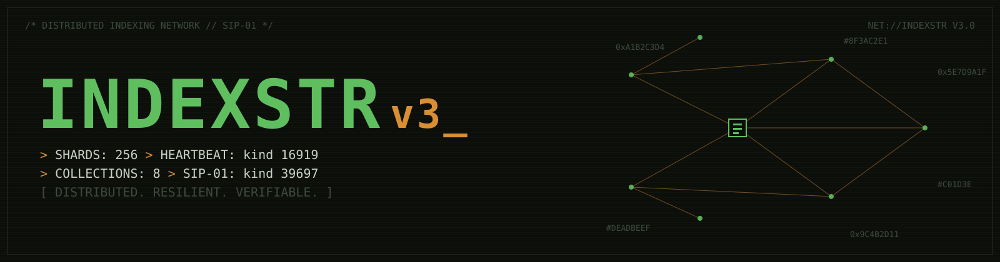
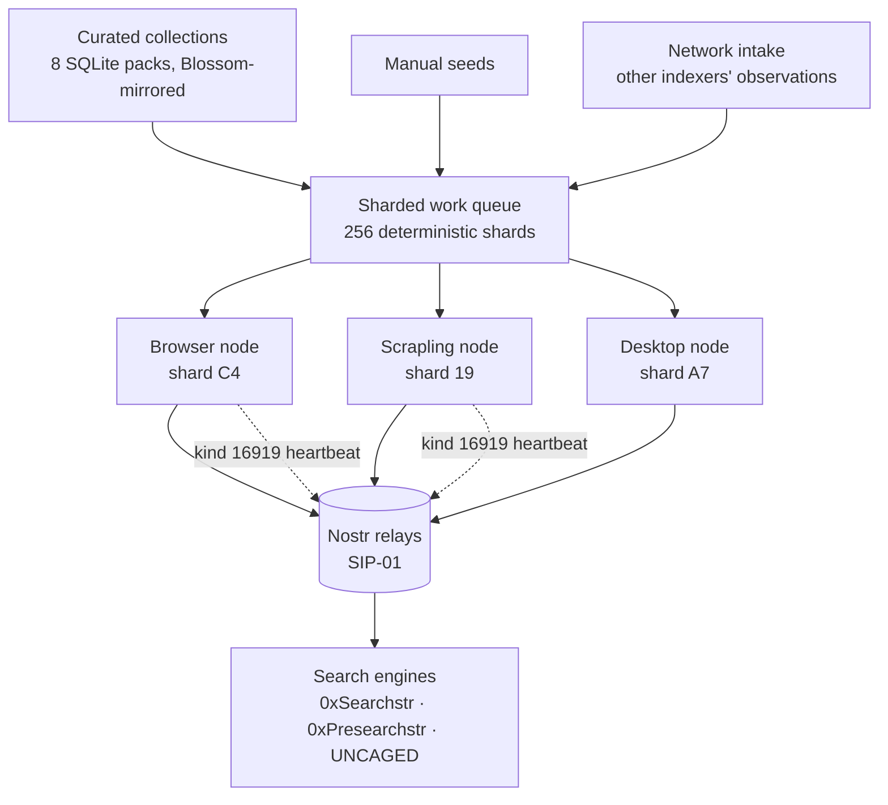

<p align="center">
  
</p>

<h1 align="center">INDEXSTR v3</h1>

<p align="center">
  <b>The decentralized web indexing network.</b><br>
  Spare capacity in, censorship-resistant index out. No coordinator. No accounts. Just Nostr.
</p>

<p align="center">
  <a href="https://github.com/NostrDanish/SIP-01"></a>
  
  
  
</p>

<p align="center">
  🔴 <b>Live:</b> <a href="https://indexstr-v3-vert.vercel.app">indexstr-v3-vert.vercel.app</a>
</p>

---

Crawlstr = *"let your browser crawl the web."* Indexstr = *"turn the community into a distributed indexing network."* Load a curated collection, press **Start Crawling**, and every page becomes a **kind 39697 web index observation** on the shared [SIP-01](https://github.com/NostrDanish/SIP-01) index — instantly searchable by [0xSearchstr](https://0xsearchstr.shakespeare.wtf), [0xPresearchstr](https://presearchstr.shakespeare.wtf), [UNCAGED](https://uncaged.shakespeare.wtf), and any SIP-01 client.

## Two runtimes, one network

| | 🏭 **Browser node** (this app) | 🐍 **Scrapling node** (`scrapling-node/`) |
|---|---|---|
| Runs on | Any browser, desktop or mobile | VPS / home server / Docker |
| Fetch stack | `fetch` + CORS proxy | [Scrapling](https://github.com/D4Vinci/Scrapling): TLS-impersonated HTTP → headless browser → stealth |
| JS rendering | ✗ | ✓ (Dynamic / Stealthy tiers) |
| Cloudflare-blocked sites | ✗ | ✓ (best effort, `solve_cloudflare`) |
| Seeds | 8 bundled SQLite collections (~76 MB) | any seeds, any scale |
| Queue / state | IndexedDB | SQLite (WAL) |
| Publishes | kind 39697 `source=indexstr/v3` + kind 16919 heartbeat | kind 39697 `source=indexstr/v3+scrapling` + heartbeat |

Byte-identical SIP-01 on the wire. The Scrapling node is roadmap item *"headless core extraction — CLI/VPS nodes with a real fetch stack"*, shipped.

## Quickstart

**Browser node** — Node.js ≥ 20, plain npm, no monorepo:

```bash
git clone https://github.com/SIP-01/indexstr-v3.git && cd indexstr-v3
npm install && npm run dev     # http://localhost:8080
npm test                       # tsc + eslint + 500+ vitest tests + build
```

Open → **Collections** tab → load a pack → **Start Crawling**. Deploys anywhere static (Vite preset, output `dist/`).

**Headless node** — see [`scrapling-node/`](scrapling-node/README.md):

```bash
cd scrapling-node
docker compose up -d           # or: pip install -r requirements.txt && python -m sip01_node --source indexstr/v3
```

## A network, not just a crawler



- **Deterministic sharding** — every URL maps to one of 256 shards; every node prefers the shard derived from its pubkey. No coordinator; same seeds in, same assignment out.
- **Heartbeats (kind 16919)** — privacy-minimal liveness: shard, coarse platform, counters coarsened to two significant figures.
- **Network intake** — nodes read *other* indexers' observations and queue unseen URLs. Every crawler is every node's discovery sensor.
- **Enrichment** — deterministic topic classification (≤8 controlled-vocabulary `t` tags + `type`), reproducible by any node, verifiable by anyone.
- **Freshness scheduling** — 24h → doubling → 30d recrawl; unchanged pages republish the same `d`/`x` as the network's liveness signal.
- **Abuse guards** — crawl-trap heuristics, per-domain caps, per-indexer intake caps (Sybil guard), SSRF guard on every path, robots.txt.

## The collections

Eight curated link packs ship in-app (`public/collections/`, parsed in-browser by a purpose-built SQLite reader, mirrored as SHA-256-verified [Blossom](https://github.com/hzrd149/blossom) blobs):

| Pack | Size | | Pack | Size |
|---|---|---|---|---|
| Top Sites | ~26 MB | | Books | ~1.3 MB |
| Awesome Lists | ~20 MB | | Movies | ~1.2 MB |
| RSS Feeds | ~19 MB | | Memes | ~1 MB |
| Music | ~10 MB | | Video Games | ~0.9 MB |

Collection URLs are indexed **exactly as listed** (`followLinks: false`) — the collection IS the crawl plan.

## What it publishes

```json
{
  "kind": 39697,
  "content": "{\"title\":\"Example Page\",\"description\":\"A page about...\"}",
  "tags": [
    ["d", "widx:9f86d081884c7d659a2feaa0c55ad015"],
    ["u", "https://example.com/page"],
    ["x", "e3b0c44298fc1c149afbf4c8996fb92427ae41e4649b934ca495991b7852b855"],
    ["v", "1"], ["l", "en"], ["source", "indexstr/v3"],
    ["network", "clearnet"], ["type", "page"],
    ["alt", "Web index observation: Example Page"]
  ]
}
```

`d` = URL identity (same across every indexer → group-by-`d`, count distinct pubkeys) · `x` = content agreement hash · full schema in [NIP.md](NIP.md) and the [canonical spec](https://github.com/NostrDanish/SIP-01/blob/main/public/spec/SIP-01.md).

## Relay pool

SIP-01 index relays first, then NIP-50 search, then broad propagation — custom relays merge in via Settings, every relay NIP-11 probe-able from the dashboard:

`relay-na1.metanomalist.com` · `test-sip-relay.sip-01test.workers.dev` · `sip-relay-2/3/4 *.workers.dev` · `relay.nostr.band` · `relay.ditto.pub` · `relay.noswhere.com` · `jskitty.cat/nostr` · `relay.primal.net` · `relay.damus.io` · `nostr.hifish.org` · Tor `.onion` twin · (`search.nos.today` read-only)

## Honest limitations (browser runtime)

- **CORS** — direct fetch first, proxy fallback (proxy sees fetched URLs — never queries, never identity; dashboard shows the split)
- **No JS rendering** — SPAs yield thin content. The Scrapling node closes exactly this gap.
- **Background throttling** — mobile browsers may suspend tabs
- **Resource limits are real** — bandwidth caps count every byte; pages/hour enforced on a sliding window

<details>
<summary><b>Changelog: v2 → v3</b></summary>

| | v2 | v3 (this) |
|---|---|---|
| Repo shape | pnpm monorepo — kept breaking Vercel | **single self-contained app**, protocol + crawler-core vendored in-tree |
| Collection DBs | "MISSING BINARIES" — copied by hand | **all 8 committed** in `public/collections/` |
| Retry backoff | cap before jitter (12.5min "10min" ceiling) | cap **after** jitter — ceiling is hard |
| Stop handling | `sleep()` could hang | already-aborted signals resolve instantly |
| Heartbeat version | `v:"1"` even for v2 | `v:"3"` + `source=indexstr/v3` |
| Dispatch | correct (robots warm on domain lane) | kept; Crawlstr-v3 zero-throughput deadlock structurally impossible |

Source tags: v1 `indexstr/1` · v2 `indexstr/v2` · v3 `indexstr/v3` — all valid SIP-01.

</details>

<details>
<summary><b>Roadmap</b></summary>

1. ~~Headless core extraction — CLI/VPS nodes with a real fetch stack~~ **shipped: [`scrapling-node/`](scrapling-node/README.md)** ✅
2. Reputation derivation — search-side scoring from signed observations
3. Sitemap-first discovery SeedProvider
4. Community seed lists over Nostr
5. Domain profiles from observation history
6. Shard leases (if sparse coverage proves patchy)

</details>

## Ecosystem

| Project | Role |
|---|---|
| **Indexstr v3** (this) | Distributed indexing network → SIP-01 publisher |
| [Crawlstr v3](https://github.com/SIP-01/Crawlstr-v3) | Lightweight browser scout |
| [SIP-01](https://github.com/NostrDanish/SIP-01) | Canonical spec + explorer |
| [0xSearchstr](https://github.com/NostrDanish/0xSearchstr) · [0xPresearchstr](https://github.com/NostrDanish/0xPresearchstr) · [UNCAGED](https://github.com/NostrDanish/UNCAGED-ENGINE) | Search engines → SIP-01 readers |

**Crawlstr finds. Indexstr maintains. Nostr distributes. Searchstr searches.**

## Privacy, honestly

No login. No tracking. Observations signed by a per-device key — never your identity. Events contain page metadata only. Relay operators see the event + your IP (that's how Nostr works); use a VPN or Tor — we recommend [NymVPN](https://nym.com/pricing?ref=aYPKAFmGpJi).

## License

MIT · *Vibed with [Shakespeare](https://shakespeare.diy)*
