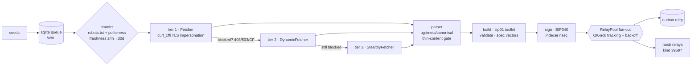

# sip01-scrapling-node

```
 ┌──────────────────────────────────────────────┐
 │  SIP-01 // headless crawler node  [ ONLINE ] │
 │  fetch ▸ parse ▸ sign ▸ publish   kind 39697 │
 └──────────────────────────────────────────────┘
```


A headless Python crawler node for **[SIP-01](https://github.com/NostrDanish/SIP-01)** — the
decentralized web-index protocol on Nostr. It crawls the web with the
[Scrapling](https://github.com/D4Vinci/Scrapling) framework and publishes one signed
**kind 39697 web index observation** per normalized URL, byte-compatible with the
browser-based v3 nodes (Crawlstr / indexstr). Built for VPS and server deployments:
no browser UI, no JavaScript required to run the node itself.



## Quickstart

**pip** (Python ≥ 3.10; 3.12 recommended):

```bash
pip install -r requirements.txt
# optional, only for the browser tiers (Dynamic/Stealthy):
scrapling install

python -m sip01_node --selftest                              # protocol vectors
python -m sip01_node --once --dry-run --seed https://example.com
SIP01_NSEC=nsec1... python -m sip01_node --config config.toml
```

If `SIP01_NSEC` is unset the node generates an indexer key on first run and
persists it in `<data_dir>/indexer.key` (mode `0600`). The nsec is never logged.

Note: re-running the dry-run against the same `./data` directory crawls
nothing — the 24h freshness cache suppresses recrawl. Delete `./data` to
start fresh.

**docker**:

```bash
docker build -t sip01-scrapling-node .
docker run --rm -v sip01-data:/data -e SIP01_NSEC=nsec1... sip01-scrapling-node
# or: cp config.example.toml config.toml && docker compose up -d
```

## Configuration

TOML file (`--config`) with env overrides (`SIP01_<OPTION_UPPER>`;
`SIP01_NSEC` is env-only, never read from a file). See
[config.example.toml](config.example.toml) for the fully commented version.

| option | default | meaning |
|---|---|---|
| `seeds` | `[]` | seed URLs (repeatable `--seed`) |
| `relays` | v3 default set | relay fan-out list |
| `source` | `indexstr/v3` | source tag; enables kind-16919 heartbeat + intake flags |
| `data_dir` | `./data` | sqlite queue/outbox, adaptive store, key file |
| `max_depth` | `3` | same-domain link discovery depth |
| `per_domain_delay` | `5.0` | politeness pacing (robots crawl-delay wins) |
| `max_page_kb` | `512` | page-size cap |
| `hourly_bandwidth_mb` | `256` | rolling hourly bandwidth budget |
| `adaptive_store` | `false` | persist Scrapling adaptive store in data dir |
| `stealth` | `auto` | `off` / `auto` / `always` browser escalation |
| `concurrency` | `4` | concurrent fetches (across domains) |
| `log_level` | `INFO` | logging verbosity |
| `fetch_timeout` | `30.0` | hard per-fetch timeout (browser tiers included) |
| `publish_timeout` | `15.0` | relay OK-ack timeout |
| `rss_discovery` | `true` | enqueue RSS/Atom/sitemap links |

## CLI

```
python -m sip01_node [--config config.toml] [--source indexstr/v3]
    [--seed URL ...] [--once] [--dry-run] [--selftest]
```

- `--selftest` — run the vendored spec §13 test vectors and exit.
- `--dry-run` — build + validate events, print them, publish nothing.
- `--once` — exit when the queue drains (otherwise crawls forever).

## Honest limitations

- **No JS-rendered adaptive parity guarantee.** The default tier is plain HTTP
  (curl_cffi). Pages that only render content via JavaScript need the browser
  tiers, which are best-effort and require `scrapling install`.
- **Stealth tier is best-effort.** Anti-bot ecosystems change daily; escalation
  triggers on 403/429/503 and known challenge markers, nothing more.
- Browser-tier fetches can hang past their own timeout (upstream Scrapling
  issues #468/#491) — this node enforces a hard `asyncio.wait_for` ceiling.
- Extraction matches the TS nodes' semantics (og:/meta/canonical/
  `article:published_time`, thin-content gate), but byte-identical text metrics
  are not guaranteed across engines.
- SSRF guard: private/loopback/CGNAT/link-local targets are refused after DNS
  resolution.

## Tests

```bash
pip install -r requirements-dev.txt   # pytest
python -m pytest tests/               # unit + integration (integration skips offline)
```

## License

MIT. Protocol: [SIP-01](https://github.com/NostrDanish/SIP-01) · kind 39697.
